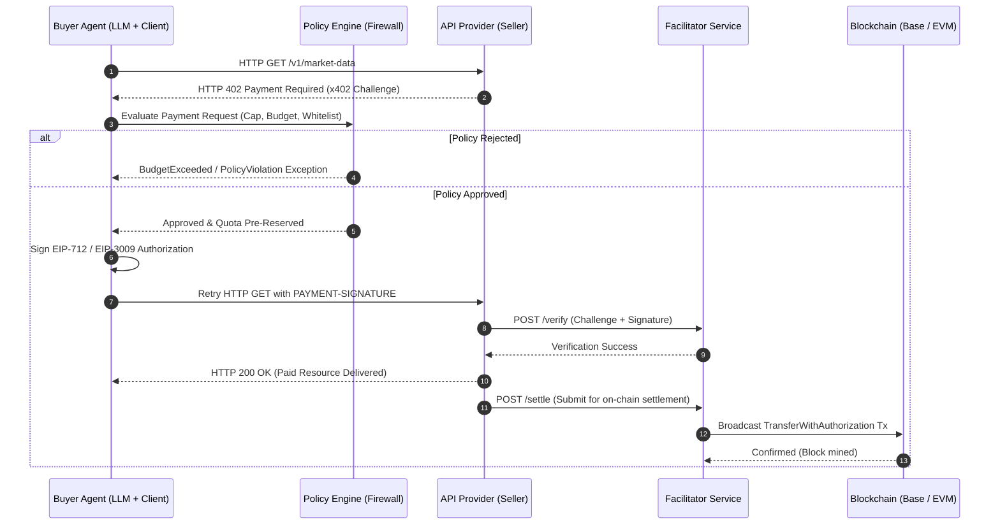

# AgentPay

<p align="center">
  <strong>The Open-Source Payment Infrastructure & Financial Firewall for Autonomous AI Agents</strong>
</p>

<p align="center">
  <a href="./LICENSE"></a>
  <a href="https://github.com/july-whj/AgentPay"></a>
  <a href="https://pnpm.io/"></a>
  <a href="https://www.python.org/"></a>
  <a href="https://spring.io/projects/spring-boot"></a>
  <a href="https://ethereum.org/en/developers/docs/standards/tokens/erc-20/"></a>
</p>

<p align="center">
  English | <a href="./README_zh.md">简体中文</a>
</p>

---

## 💡 What is AgentPay?

**AgentPay** is an open-source, non-custodial payment infrastructure and financial security layer built for autonomous AI agents, LLM applications, and modern API ecosystems. Built on top of the **HTTP 402 Payment Required (x402 V2)** protocol, AgentPay provides a unified polyglot bridge (**TypeScript + Python + Java/Spring Boot**) allowing agents to autonomously purchase tools, data, and compute resources while enforcing strict human-defined financial guardrails.

AgentPay is **NOT** a simple wrapper around payment SDKs. It addresses core distributed systems and risk engineering challenges in real-world agentic transactions:
* **Financial Hallucination & Self-Granting**: Agents might hallucinate, enter recursive loops, or attempt unauthorized multi-thousand dollar transactions.
* **RPC Timeouts & Double-Spending**: Blockchains and distributed HTTP networks suffer from latency spikes. A network timeout does not mean a transaction failed.
* **Gas Token Management Burden**: AI agents should not need to manage volatile gas tokens (ETH/MATIC) just to pay for 0.001 USDC API queries.
* **Language Ecosystem Fragmentation**: AI agents and client frameworks live primarily in Python (LangChain, CrewAI, AutoGen) and TypeScript, while enterprise API monetization backends live in Java/Spring Boot.

---

## 🌟 Core Pillars & Architectural Innovations

### 1. Independent Financial Firewall (Policy Engine)
LLMs propose actions and invoke tools, but **they can never approve or grant themselves financial permissions**.
* **Zero Trust Boundary**: Decoupled policy engine running outside the LLM execution context.
* **Fine-Grained Budgeting**: Enforces maximum per-transaction caps, 24-hour rolling budgets, lifetime limits, and merchant/resource whitelists.
* **Circuit Breakers**: Detects high-frequency anomalies and recursive loop spending patterns, instantly halting payment execution and alerting operators.

### 2. Tri-State Decoupled State Machine
Traditional e-commerce bundles payment and delivery into a single lifecycle. AgentPay strictly separates execution into three asynchronous state dimensions:
* **Payment Intent**: `CREATED -> AUTHORIZED -> VERIFIED -> [COMPLETED | REJECTED | EXPIRED | CANCELLED]`
* **Settlement State**: `NOT_STARTED -> SUBMITTED -> PENDING -> [CONFIRMED | FAILED | REORGED | UNKNOWN]`
* **Fulfillment State**: `NOT_STARTED -> PROCESSING -> [DELIVERED | FAILED | RECOVERY_REQUIRED]`

> **Guiding Principle:** *Network timeout != failure.* If settlement is confirmed on-chain but API delivery times out, AgentPay guarantees idempotent reconciliation and recovery without double charges.

### 3. Gasless Micro-Settlements (EIP-712 & EIP-3009)
* AI Agents only generate cryptographically verified off-chain authorizations (e.g., USDC `TransferWithAuthorization`).
* Facilitator nodes sponsor gas and submit batches on-chain, freeing Agent developers from maintaining volatile native gas balances.

### 4. Cross-Language Parity (TypeScript + Python + Java/Spring Boot)
* **TypeScript Ecosystem**: Reference client SDK, transparent HTTP 402 interceptors (`@agentpay/agent-client`), Express middleware, Fastify plugins, and MCP (Model Context Protocol) tool wrappers.
* **Python Ecosystem**: Native client SDK (`agentpay`), transparent transport interceptors (`httpx`, `requests`, `aiohttp`), first-class LangChain / CrewAI / LlamaIndex paid tool wrappers, and FastAPI middleware.
* **Java / Spring Boot Ecosystem**: Enterprise-grade provider SDK (`agentpay-spring-boot-starter`), declarative `@RequiresPayment` method annotations, and high-throughput Facilitator services.
* **Shared Test Vectors**: Cross-language conformance suite (`specs/conformance/test-vectors/`) ensuring 100% protocol and cryptographic compatibility across all three runtimes.

---

## 📐 System Architecture



---

## 📂 Repository Structure

```text
AgentPay/
├── specs/                           # Cross-language specifications & test vectors
│   ├── architecture.md              # System architecture, topology & protocols
│   ├── domain-model.md              # Data schemas, database tables & precision rules
│   ├── payment-state-machine.md     # Tri-state decoupling & recovery lifecycle
│   ├── security-model.md            # Threat model, financial firewall & cryptography
│   └── conformance/test-vectors/    # Shared JSON test vectors (TS & Java)
│
├── packages/                        # TypeScript Monorepo (pnpm workspace)
│   ├── core/                        # Domain models, state machines, policy interfaces
│   ├── x402-v2/                     # x402 V2 protocol codec, challenge parser
│   ├── evm/                         # EIP-712, EIP-3009 signature builders
│   ├── wallet/                      # LocalSigner, KMS abstraction
│   ├── facilitator-client/          # HTTP client for Facilitator /verify & /settle
│   ├── policy/                      # Policy engine (budgets, whitelists, rate limits)
│   ├── express/                     # Express seller middleware
│   ├── fastify/                     # Fastify seller plugin
│   ├── mcp/                         # Model Context Protocol paid tool wrapper
│   ├── agent-client/                # Transparent HTTP interceptor for Buyer Agents
│   └── testing/                     # Shared test fixtures & mocks
│
├── python/                          # Python SDK (Poetry / Hatch / UV workspace)
│   ├── agentpay-core/               # Domain models, x402 V2 codecs & typing
│   ├── agentpay-client/             # Transparent httpx/requests/aiohttp 402 interceptor
│   ├── agentpay-policy/             # Python Financial Firewall & budget engine
│   ├── agentpay-fastapi/            # FastAPI provider middleware
│   └── agentpay-langchain/          # LangChain, CrewAI & LlamaIndex tool wrappers
│
├── java/                            # Java / Spring Boot (Gradle multi-project)
│   ├── agentpay-core/               # Shared domain entities & state machines
│   ├── agentpay-x402/               # Java x402 V2 protocol parser & serializer
│   ├── agentpay-evm/                # Web3j EIP-712 signature verification
│   ├── agentpay-facilitator/        # Facilitator client and integration interfaces
│   ├── agentpay-policy/             # Financial firewall implementation (Spring)
│   ├── agentpay-spring-boot-starter/# Auto-configuration & @RequiresPayment annotation
│   ├── agentpay-mcp/                # Spring AI / MCP integration
│   └── agentpay-testkit/            # Test harness & mock facilitator
│
├── services/                        # Standalone Deployable Services
│   ├── facilitator/                 # Reference Facilitator service
│   ├── control-plane/               # Admin & audit dashboard API
│   └── reconciliation/              # Background recovery & reconciliation worker
│
├── examples/                        # End-to-end runnable examples
│   ├── typescript-seller/           # Express/Fastify protected API example
│   ├── typescript-buyer/            # AgentPayClient calling protected API
│   ├── java-spring-seller/          # Spring Boot protected endpoint example
│   ├── mcp-paid-tool/               # Paid MCP tool demonstration
│   └── local-devnet/                # Local anvil/hardhat + mock Facilitator environment
│
├── infra/
│   ├── docker/                      # Docker compose for PostgreSQL & local devnet
│   └── postgres/                    # Database DDL and initialization migrations
│
├── AGENTPAY_CONTEXT.md              # Project context capsule & AI memory
├── README.md                        # Project documentation overview
├── LICENSE                          # Apache-2.0
├── SECURITY.md                      # Security vulnerability disclosure policy
└── CONTRIBUTING.md                  # Developer contribution guidelines
```

---

## 🔒 Security & Disclosure

Security is fundamental to AgentPay. Financial controls, cryptographic key isolation, and transaction limits are enforced at the infrastructure level. If you identify a potential security vulnerability, please refer to our [SECURITY.md](./SECURITY.md) for responsible disclosure procedures.

---

## 📄 License

AgentPay is open-source software licensed under the [Apache License, Version 2.0](./LICENSE).
