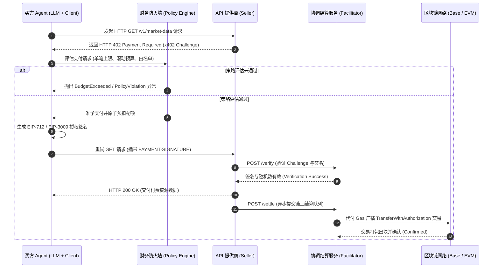

# AgentPay

<p align="center">
  <strong>专为自主 AI Agent 打造的开源支付基础设施与财务防火墙</strong>
</p>

<p align="center">
  <a href="./LICENSE"></a>
  <a href="https://github.com/july-whj/AgentPay"></a>
  <a href="https://pnpm.io/"></a>
  <a href="https://spring.io/projects/spring-boot"></a>
  <a href="https://ethereum.org/en/developers/docs/standards/tokens/erc-20/"></a>
</p>

<p align="center">
  <a href="./README.md">English</a> | 简体中文
</p>

---

## 💡 什么是 AgentPay？

**AgentPay** 是一套专为自主 AI Agent、大语言模型应用与现代 API 生态系统打造的开源、非托管支付基础设施与财务安全层。基于 **HTTP 402 Payment Required (x402 V2)** 协议，AgentPay 提供了统一的跨语言双技术栈桥梁（**TypeScript + Java / Spring Boot**），允许智能体自主采购工具、数据与算力资源，同时在底层强制实施由人类定义的严苛财务安全防线。

AgentPay **绝非**简单的支付 SDK 封装。它专为解决真实 Agent 交互场景下的分布式系统复杂性与资金风险工程难题而生：
* **金融幻觉与自我授权风险**：LLM 可能会产生幻觉、陷入递归死循环或发起未经授权的巨额交易。
* **RPC 超时与双花隐患**：区块链节点与分布式 HTTP 网络常出现偶发延迟与超时，但网络超时并不等同于支付失败。
* **Gas 治理负担**：AI Agent 不应为了支付 0.001 USDC 的 API 调用费用而被迫管理波动的原生 Gas 代币（如 ETH/MATIC）。
* **技术栈生态割裂**：AI Agent 与上层应用多以 TypeScript/Python 为主，而企业级 API 商业化变现后端则广泛依托于 Java / Spring Boot。

---

## 🌟 核心支柱与架构创新

### 1. 独立的财务防火墙（策略引擎 Policy Engine）
LLM 可以提议调用工具或发起交易，但**绝不能自我批准或修改财务权限**。
* **零信任边界**：策略引擎运行于独立的执行环境中，完全脱离 LLM 上下文。
* **细粒度预算控制**：强制约束单笔交易限额、24 小时滚动预算、终身额度上限及商户/资源白名单。
* **异常熔断器**：实时识别高频异常与递归死循环耗资模式，毫秒级熔断冻结并上报告警。

### 2. 三态解耦状态机（Tri-State Decoupled State Machine）
传统电商将支付与交付耦合在单一生命周期中。AgentPay 严格将其解耦为三个异步独立的状态维度：
* **支付意图态（Payment Intent）**：`CREATED -> AUTHORIZED -> VERIFIED -> [COMPLETED | REJECTED | EXPIRED | CANCELLED]`
* **链上结算态（Settlement State）**：`NOT_STARTED -> SUBMITTED -> PENDING -> [CONFIRMED | FAILED | REORGED | UNKNOWN]`
* **业务交付态（Fulfillment State）**：`NOT_STARTED -> PROCESSING -> [DELIVERED | FAILED | RECOVERY_REQUIRED]`

> **核心设计准则**：*网络超时 $\neq$ 交易失败*。若链上结算已确认但业务端交付发生超时，AgentPay 保证通过幂等重试机制进行安全恢复，坚决杜绝重复扣款与资产损失。

### 3. 无 Gas 微支付结算（EIP-712 与 EIP-3009）
* AI Agent 仅需生成经密码学签名的链下授权（例如 USDC 的 `TransferWithAuthorization`）。
* 由 Facilitator（协调清算节点）代付 Gas 并批量上链提交，免除 Agent 开发者维护原生代币余额的繁琐负担。

### 4. 跨语言对齐（TypeScript + Java / Spring Boot）
* **TypeScript 生态**：标准客户端 SDK、透明 HTTP 402 拦截器（`@agentpay/agent-client`）、Express 中间件、Fastify 插件以及 MCP（Model Context Protocol）付费工具包装器。
* **Java / Spring Boot 生态**：企业级提供商 SDK（`agentpay-spring-boot-starter`）、声明式 `@RequiresPayment` 方法注解以及高吞吐 Facilitator 基础设施。
* **共享测试向量**：跨语言一致性套件（`specs/conformance/test-vectors/`），确保协议解析与密码学验证 100% 行为一致。

---

## 📐 系统交互架构



---

## 📂 项目工程结构

```text
AgentPay/
├── specs/                           # 跨语言规范与测试向量
│   ├── architecture.md              # 系统架构、拓扑与协议设计规范
│   ├── domain-model.md              # 领域模型定义、PostgreSQL 结构与精度规范
│   ├── payment-state-machine.md     # 三态解耦状态机与异步恢复机制
│   ├── security-model.md            # 威胁模型、财务防火墙与密码学安全边界
│   └── conformance/test-vectors/    # 共享 JSON 测试向量 (TS 与 Java)
│
├── packages/                        # TypeScript Monorepo (pnpm workspace)
│   ├── core/                        # 领域核心模型、状态机、策略接口定义
│   ├── x402-v2/                     # x402 V2 协议编解码器、Challenge 解析器
│   ├── evm/                         # EIP-712、EIP-3009 签名构建器
│   ├── wallet/                      # LocalSigner 本地签名器、KMS 抽象层
│   ├── facilitator-client/          # Facilitator /verify 与 /settle 客户端
│   ├── policy/                      # 策略引擎实现 (预算、白名单、频控)
│   ├── express/                     # Express 卖方中间件
│   ├── fastify/                     # Fastify 卖方插件
│   ├── mcp/                         # Model Context Protocol 付费工具封装
│   ├── agent-client/                # 买方 Agent 透明 HTTP 拦截器
│   └── testing/                     # 共享测试固件与 Mock 模拟套件
│
├── java/                            # Java / Spring Boot (Gradle multi-project)
│   ├── agentpay-core/               # 共享领域实体与状态机定义
│   ├── agentpay-x402/               # Java 版 x402 V2 协议编解码器
│   ├── agentpay-evm/                # Web3j EIP-712 签名验证模块
│   ├── agentpay-facilitator/        # Facilitator 客户端与集成接口
│   ├── agentpay-policy/             # 财务防火墙实现 (Spring)
│   ├── agentpay-spring-boot-starter/# 自动装配器与 @RequiresPayment 核心注解
│   ├── agentpay-mcp/                # Spring AI / MCP 工具集成
│   └── agentpay-testkit/            # 测试组件与 Mock Facilitator
│
├── services/                        # 独立可部署微服务
│   ├── facilitator/                 # 参考 Facilitator 清算服务
│   ├── control-plane/               # 管理后台与审计面板 API
│   └── reconciliation/              # 后台对账与状态自愈 Worker
│
├── examples/                        # 端到端运行示例
│   ├── typescript-seller/           # Express/Fastify 受保护 API 示例
│   ├── typescript-buyer/            # AgentPayClient 消费受保护 API 示例
│   ├── java-spring-seller/          # Spring Boot 受保护端点示例
│   ├── mcp-paid-tool/               # 付费 MCP 工具演示
│   └── local-devnet/                # 本地 anvil/hardhat + Mock Facilitator 环境
│
├── infra/
│   ├── docker/                      # Docker compose 本地基础设施编排
│   └── postgres/                    # 数据库 DDL 与初始迁移脚本
│
├── AGENTPAY_CONTEXT.md              # 项目上下文胶囊与 AI Agent 架构记忆
├── README.md                        # 英文主文档 (默认)
├── README_zh.md                     # 中文主文档
├── LICENSE                          # Apache-2.0
├── SECURITY.md                      # 安全漏洞披露与响应策略
└── CONTRIBUTING.md                  # 开发者贡献指南
```

---

## 🔒 安全与漏洞披露

安全是 AgentPay 项目的核心基石。财务风控、私钥隔离与交易配额均在基础设施底层强制执行。若您发现潜在安全漏洞，请查阅 [SECURITY.md](./SECURITY.md) 获取负责任的私密披露流程。

---

## 📄 开源许可证

AgentPay 基于 [Apache License 2.0](./LICENSE) 协议开源发布。
