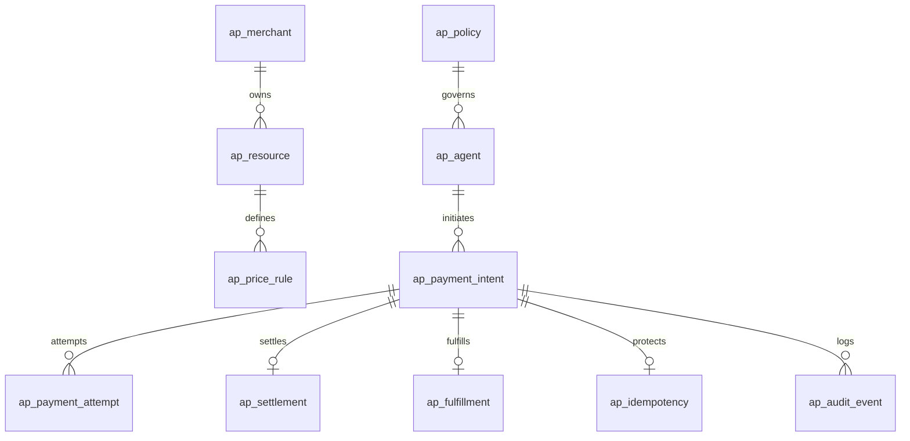

# AgentPay Domain Model & Database Specification

## 1. Domain Entities & Bounded Contexts

AgentPay partitions its data architecture into five distinct bounded contexts:
1. **Identity & Governance Context:** Merchant profiles, Agent identities, and cryptographically verified public keys.
2. **Policy & Risk Context:** Financial guardrails, per-transaction spending caps, rolling budgets, and whitelist rules.
3. **Resource & Pricing Context:** Monetized APIs, MCP tool definitions, and asset pricing schemes.
4. **Payment & Settlement Context:** Payment intents, verification attempts, blockchain settlement transactions, and Facilitator states.
5. **Fulfillment & Audit Context:** API response caching, recovery workflows, and tamper-evident audit logs.

---

## 2. PostgreSQL Schema & Entity Definitions

### 2.1 Entity Relationship Diagram



---

### 2.2 Table Definitions & Specifications

#### 1. `ap_merchant`
Represents an API provider, service operator, or organization offering paid endpoints.
* `id` (`VARCHAR(64)` PRIMARY KEY): Unique merchant identifier (e.g., `mch_01h...`).
* `name` (`VARCHAR(255)` NOT NULL): Business or provider name.
* `payout_address` (`VARCHAR(66)` NOT NULL): On-chain recipient address (EVM 0x...).
* `default_network` (`VARCHAR(32)` NOT NULL): CAIP-2 network format (e.g., `eip155:8453`).
* `status` (`VARCHAR(32)` NOT NULL): `ACTIVE`, `SUSPENDED`, `ARCHIVED`.
* `created_at` (`TIMESTAMPTZ` NOT NULL DEFAULT NOW()).
* `updated_at` (`TIMESTAMPTZ` NOT NULL DEFAULT NOW()).

#### 2. `ap_resource`
A paid endpoint, method, tool, or digital asset.
* `id` (`VARCHAR(64)` PRIMARY KEY): Resource ID (e.g., `res_01h...`).
* `merchant_id` (`VARCHAR(64)` NOT NULL REFERENCES `ap_merchant(id)`).
* `resource_uri` (`VARCHAR(512)` NOT NULL): Target route or MCP tool name (e.g., `/v1/data/market-snapshot`).
* `http_method` (`VARCHAR(16)` NOT NULL): HTTP verb (`GET`, `POST`, etc.) or `MCP_TOOL`.
* `description` (`TEXT`): Human-readable capability description.
* `is_active` (`BOOLEAN` NOT NULL DEFAULT TRUE).
* `created_at` (`TIMESTAMPTZ` NOT NULL DEFAULT NOW()).

#### 3. `ap_price_rule`
Defines the required payment criteria for accessing an `ap_resource`.
* `id` (`VARCHAR(64)` PRIMARY KEY): Rule ID (e.g., `prc_01h...`).
* `resource_id` (`VARCHAR(64)` NOT NULL REFERENCES `ap_resource(id)`).
* `network_id` (`VARCHAR(32)` NOT NULL): CAIP-2 identifier (e.g., `eip155:84532`).
* `asset_address` (`VARCHAR(66)` NOT NULL): Contract address of the stablecoin (e.g., USDC `0x036C...`).
* `asset_symbol` (`VARCHAR(16)` NOT NULL): Symbol for audit and display (`USDC`, `EURC`).
* `amount_base_units` (`NUMERIC(38,0)` NOT NULL): Micro-units required (e.g., `10000` = 0.01 USDC with 6 decimals).
* `scheme` (`VARCHAR(32)` NOT NULL DEFAULT 'EIP-3009'): `EIP-712`, `EIP-3009`, `ERC-20-TRANSFER`.
* `valid_until` (`TIMESTAMPTZ`): Optional expiration date for promotional or dynamic pricing.

#### 4. `ap_policy`
Financial guardrail rules assigned to autonomous agents.
* `id` (`VARCHAR(64)` PRIMARY KEY): Policy ID (e.g., `pol_01h...`).
* `name` (`VARCHAR(128)` NOT NULL): Policy label.
* `max_per_tx_base_units` (`NUMERIC(38,0)` NOT NULL): Maximum allowable cost per single invocation.
* `rolling_budget_base_units` (`NUMERIC(38,0)` NOT NULL): Total allowable spend per rolling cycle.
* `spent_base_units` (`NUMERIC(38,0)` NOT NULL DEFAULT 0): Currently committed spending within active cycle.
* `budget_window_seconds` (`INTEGER` NOT NULL DEFAULT 86400): Rolling window duration (default 24h).
* `window_started_at` (`TIMESTAMPTZ` NOT NULL DEFAULT NOW()): Cycle timestamp start for auto-reset.
* `whitelist_domains` (`JSONB` NOT NULL DEFAULT '[]'::jsonb): Allowed domains/endpoints.
* `circuit_breaker_threshold` (`INTEGER` NOT NULL DEFAULT 10): Consecutive failure or burst limit triggering auto-freeze.
* `is_frozen` (`BOOLEAN` NOT NULL DEFAULT FALSE): Manual or circuit breaker freeze flag.

#### 5. `ap_agent`
An autonomous AI agent client authorized to transact on behalf of a user or system.
* `id` (`VARCHAR(64)` PRIMARY KEY): Agent ID (e.g., `agt_01h...`).
* `public_key` (`VARCHAR(66)` NOT NULL UNIQUE): Agent's EVM wallet address (`0x...`).
* `policy_id` (`VARCHAR(64)` NOT NULL REFERENCES `ap_policy(id)`).
* `status` (`VARCHAR(32)` NOT NULL): `ACTIVE`, `FROZEN`, `REVOKED`.
* `created_at` (`TIMESTAMPTZ` NOT NULL DEFAULT NOW()).

#### 6. `ap_payment_intent`
High-level intent tracking the business transaction across its full lifecycle.
* `id` (`VARCHAR(64)` PRIMARY KEY): Intent ID (e.g., `pi_01h...`).
* `agent_id` (`VARCHAR(64)` NOT NULL REFERENCES `ap_agent(id)`).
* `merchant_id` (`VARCHAR(64)` NOT NULL REFERENCES `ap_merchant(id)`).
* `resource_id` (`VARCHAR(64)` NOT NULL REFERENCES `ap_resource(id)`).
* `amount_base_units` (`NUMERIC(38,0)` NOT NULL): Authorized transaction amount.
* `asset_address` (`VARCHAR(66)` NOT NULL): Token contract.
* `network_id` (`VARCHAR(32)` NOT NULL): CAIP-2 network string.
* `status` (`VARCHAR(32)` NOT NULL): `CREATED`, `AUTHORIZED`, `VERIFIED`, `COMPLETED`, `REJECTED`, `EXPIRED`, `CANCELLED`.
* `idempotency_key` (`VARCHAR(128)` NOT NULL UNIQUE): Unique deduplication token.
* `created_at` (`TIMESTAMPTZ` NOT NULL DEFAULT NOW()).
* `updated_at` (`TIMESTAMPTZ` NOT NULL DEFAULT NOW()).

#### 7. `ap_payment_attempt`
Log of each discrete x402 challenge-response authorization submitted.
* `id` (`VARCHAR(64)` PRIMARY KEY): Attempt ID (e.g., `pa_01h...`).
* `intent_id` (`VARCHAR(64)` NOT NULL REFERENCES `ap_payment_intent(id)`).
* `raw_challenge` (`TEXT` NOT NULL): Base64/JSON challenge from HTTP 402 header.
* `raw_signature` (`TEXT` NOT NULL): EIP-712 signature or authorization payload.
* `nonce` (`VARCHAR(66)` NOT NULL): EIP-3009 cryptographic nonce.
* `valid_after` (`BIGINT` NOT NULL): Unix timestamp lower bound.
* `valid_before` (`BIGINT` NOT NULL): Unix timestamp upper bound.
* `status` (`VARCHAR(32)` NOT NULL): `SUBMITTED`, `VERIFIED`, `INVALID`, `EXPIRED`.
* `created_at` (`TIMESTAMPTZ` NOT NULL DEFAULT NOW()).

#### 8. `ap_settlement`
State of blockchain transaction settlement and consensus.
* `id` (`VARCHAR(64)` PRIMARY KEY): Settlement ID (e.g., `stl_01h...`).
* `intent_id` (`VARCHAR(64)` NOT NULL UNIQUE REFERENCES `ap_payment_intent(id)`).
* `facilitator_id` (`VARCHAR(64)` NOT NULL): ID of the facilitator relaying the transaction.
* `tx_hash` (`VARCHAR(66)`): EVM transaction hash.
* `network_id` (`VARCHAR(32)` NOT NULL): CAIP-2 network string.
* `status` (`VARCHAR(32)` NOT NULL): `NOT_STARTED`, `SUBMITTED`, `PENDING`, `CONFIRMED`, `FAILED`, `REORGED`, `UNKNOWN`.
* `block_number` (`BIGINT`): Block in which transaction was mined.
* `confirmations` (`INTEGER` NOT NULL DEFAULT 0): Number of block confirmations observed.
* `gas_used` (`NUMERIC(38,0)`): Actual gas consumed.
* `error_message` (`TEXT`): Revert reason or facilitator error.
* `submitted_at` (`TIMESTAMPTZ`): Submission timestamp.
* `settled_at` (`TIMESTAMPTZ`): Block confirmation timestamp.

#### 9. `ap_fulfillment`
Delivery tracking for the underlying API resource or MCP tool result.
* `id` (`VARCHAR(64)` PRIMARY KEY): Fulfillment ID (e.g., `flf_01h...`).
* `intent_id` (`VARCHAR(64)` NOT NULL UNIQUE REFERENCES `ap_payment_intent(id)`).
* `status` (`VARCHAR(32)` NOT NULL): `NOT_STARTED`, `PROCESSING`, `DELIVERED`, `FAILED`, `RECOVERY_REQUIRED`.
* `response_status_code` (`INTEGER`): HTTP status code delivered to agent (e.g., 200).
* `response_hash` (`VARCHAR(64)`): SHA-256 hash of delivered payload for integrity verification.
* `retry_count` (`INTEGER` NOT NULL DEFAULT 0): Recovery attempts count.
* `delivered_at` (`TIMESTAMPTZ`): Final delivery timestamp.

#### 10. `ap_idempotency`
Guarantees strict once-and-only-once execution of payments and resources.
* `idempotency_key` (`VARCHAR(128)` PRIMARY KEY).
* `request_hash` (`VARCHAR(64)` NOT NULL): SHA-256 digest of original request path, headers, and body.
* `response_cache` (`JSONB`): Cached response returned on duplicate queries.
* `status` (`VARCHAR(32)` NOT NULL): `IN_FLIGHT`, `COMPLETED`, `FAILED`.
* `expires_at` (`TIMESTAMPTZ` NOT NULL): Expiry time after which key can be recycled.

#### 11. `ap_audit_event`
Append-only tamper-evident log for policy evaluations, balance updates, and operational overrides.
* `id` (`BIGSERIAL` PRIMARY KEY).
* `intent_id` (`VARCHAR(64)` REFERENCES `ap_payment_intent(id)`).
* `agent_id` (`VARCHAR(64)` NOT NULL).
* `event_type` (`VARCHAR(64)` NOT NULL): `POLICY_EVALUATION`, `BUDGET_RESERVED`, `SIGNATURE_VERIFIED`, `SETTLEMENT_CONFIRMED`, `CIRCUIT_BREAKER_TRIGGERED`.
* `payload` (`JSONB` NOT NULL): Detailed context, inputs, and state snapshot.
* `created_at` (`TIMESTAMPTZ` NOT NULL DEFAULT NOW()).

---

## 3. Critical Data Rules & Precision Standards

1. **Strict Prohibition of Floating-Point Types:**
   * Floating-point numbers (`FLOAT`, `DOUBLE`, `REAL`) are **strictly prohibited** in all financial columns and computation.
   * All token amounts must be stored as `NUMERIC(38,0)` representing the integer base units (e.g., 6 decimals for USDC where 1 USDC = `1000000`).
2. **CAIP-2 Chain Identifiers:**
   * Chain identifiers must be formatted as `<namespace>:<reference>` (e.g., `eip155:8453` for Base, `eip155:1` for Ethereum Mainnet).
3. **Atomic Quota Deduction & Concurrency Lock:**
   * Policy quota deduction must be executed with atomic compare-and-swap SQL:
     ```sql
     UPDATE ap_policy
     SET spent_base_units = spent_base_units + :amount,
         updated_at = NOW()
     WHERE id = :policyId
       AND is_frozen = FALSE
       AND (spent_base_units + :amount) <= rolling_budget_base_units
       AND :amount <= max_per_tx_base_units;
     ```
   * If `ROW_COUNT == 0`, the transaction is instantly rejected as a budget overdraw, eliminating race conditions across distributed agent threads.
