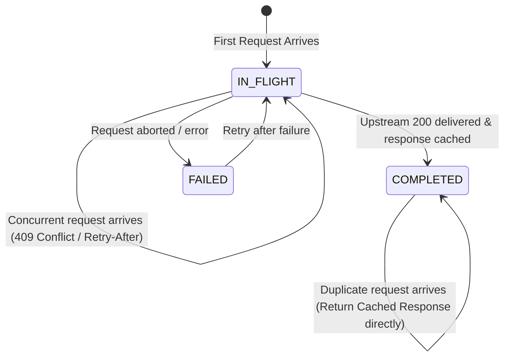

# AgentPay Payment State Machine & Idempotency Specification

> **Specification Version:** 1.1.0  
> **Status:** Standard  
> **Target Runtimes:** Python SDK (`python/agentpay`), Self-hosted Gateway, Cross-Language Conformance  
> **Task Tracking:** 2026 Plan Milestone M2 (Tasks T1.1, T4.1, T4.2, T4.3, T5.4)

---

## 1. Tri-State Decoupling Philosophy

In distributed agentic commerce and Web3 micropayments, bundling payment verification, on-chain consensus, and API resource delivery into a single synchronous state is fundamentally flawed:
* **Network Latency & RPC Drops:** Blockchain RPCs experience latency spikes. A network timeout during broadcast does **NOT** mean the transaction failed or won't be mined.
* **Double-Spending Risk:** Naively retrying on timeout produces duplicate on-chain transfers and budget depletion.
* **Orphaned Settlements:** If funds settle on-chain but the upstream API server crashes before delivering the HTTP response, the buyer loses funds without receiving the resource.

**AgentPay solves this by decoupling the transaction into three independent asynchronous state dimensions:**

```text
[1. Payment Intent State]
CREATED -> AUTHORIZED -> VERIFIED -> [COMPLETED | REJECTED | EXPIRED | CANCELLED]

[2. Settlement State]
NOT_STARTED -> SUBMITTED -> PENDING -> [CONFIRMED | FAILED | REORGED | UNKNOWN]

[3. Fulfillment State]
NOT_STARTED -> PROCESSING -> [DELIVERED | FAILED | RECOVERY_REQUIRED]
```

---

## 2. Rigorous State Transition & Guard Matrices

Any state transition not explicitly allowed in these matrices is an **Illegal State Transition** and **MUST** raise an `InvalidStateTransitionError`.

### 2.1 Dimension 1: Payment Intent Lifecycle

Tracks the high-level business contract between the Buyer Agent and the Seller/Gateway.

| Current State (`From`) | Trigger Event | Guard Condition | Next State (`To`) | Side Effects & Actions |
| :--- | :--- | :--- | :--- | :--- |
| `[*]` | `INTENT_INIT` | Request challenge parsed & validated | `CREATED` | Initialize audit record & idempotency slot. |
| `CREATED` | `POLICY_APPROVE` | Policy evaluation passes, quota reserved | `AUTHORIZED` | Lock quota in policy ledger (`RESERVED`), wake signer. |
| `CREATED` | `POLICY_DENY` | Cap exceeded, budget exhausted, or unlisted | `REJECTED` | No signature generated; raise `BudgetExceededException`. |
| `CREATED` | `CHALLENGE_TIMEOUT` | Current time >= `validBefore` | `EXPIRED` | Discard challenge, clean up intent. |
| `AUTHORIZED` | `SIGNATURE_VERIFIED` | Facilitator validates EIP-712 & nonce unused | `VERIFIED` | Begin fulfillment; initiate background settlement. |
| `AUTHORIZED` | `VERIFY_FAILED` | Cryptographic signature invalid or nonce used | `REJECTED` | `release_reservation()`; raise `PaymentVerificationError`. |
| `AUTHORIZED` | `CLIENT_ABORT` | Network error prior to sending signature | `CANCELLED` | `release_reservation()`; quota immediately restored. |
| `VERIFIED` | `FULFILL_SUCCESS` | Resource delivered (200 OK) to buyer | `COMPLETED` | `commit_reservation()`; mark idempotency completed. |
| `VERIFIED` | `DELIVERY_FAILED` | Upstream returned 5xx / timeout post-verify | `VERIFIED` | Enter `RECOVERY_REQUIRED` in fulfillment dimension. |
| `COMPLETED` | *Any Event* | Final state (Terminal) | *Terminal* | Raise `TerminalStateModificationError`. |
| `REJECTED` | *Any Event* | Final state (Terminal) | *Terminal* | Raise `TerminalStateModificationError`. |
| `EXPIRED` | *Any Event* | Final state (Terminal) | *Terminal* | Raise `TerminalStateModificationError`. |
| `CANCELLED` | *Any Event* | Final state (Terminal) | *Terminal* | Raise `TerminalStateModificationError`. |

---

### 2.2 Dimension 2: Settlement Lifecycle (On-Chain / Facilitator)

Tracks the physical transfer of funds via Facilitator and EVM blockchain.

| Current State (`From`) | Trigger Event | Guard Condition | Next State (`To`) | Actions & Rules |
| :--- | :--- | :--- | :--- | :--- |
| `[*] / NOT_STARTED` | `SUBMIT_SETTLEMENT` | Verification token valid | `SUBMITTED` | Enqueue in Facilitator batch pipeline. |
| `SUBMITTED` | `BROADCAST_SUCCESS` | Tx hash received from mempool | `PENDING` | Store `tx_hash`; start confirmation polling. |
| `SUBMITTED` | `BROADCAST_TIMEOUT` | RPC timeout or network partition | `UNKNOWN` | **DO NOT RESUBMIT.** Flag for `reconcile()` polling. |
| `PENDING` | `BLOCK_CONFIRMED` | Block confirmations >= threshold (e.g. 2) | `CONFIRMED` | Final settlement achieved; record block number & gas. |
| `PENDING` | `RPC_TIMEOUT` | RPC node unresponsive during polling | `UNKNOWN` | Retain `tx_hash`; flag for background probe. |
| `PENDING` | `REORG_DETECTED` | Block hash altered; receipt evicted | `REORGED` | Schedule re-submission with bumped gas. |
| `PENDING` | `TX_REVERTED` | Contract revert (e.g., authorization expired) | `FAILED` | Record revert reason; trigger reconciliation alert. |
| `UNKNOWN` | `PROBE_FOUND_RECEIPT` | Worker queries receipt from alternate RPC | `CONFIRMED` | Recovered from timeout; mark confirmed. |
| `UNKNOWN` | `PROBE_FOUND_PENDING` | Worker finds tx in mempool | `PENDING` | Restore polling monitor. |
| `UNKNOWN` | `PROBE_DEFINITIVE_ABSENT` | Nonce unused and tx absent after TTL | `FAILED` | Safe to resubmit or abort without double-deduction. |

---

### 2.3 Dimension 3: Fulfillment Lifecycle (API Delivery)

Tracks whether the Buyer Agent successfully received the paid data/compute.

| Current State (`From`) | Trigger Event | Guard Condition | Next State (`To`) | Actions & Rules |
| :--- | :--- | :--- | :--- | :--- |
| `[*] / NOT_STARTED` | `DISPATCH_UPSTREAM` | Verification passes | `PROCESSING` | Proxy request to upstream target API. |
| `PROCESSING` | `UPSTREAM_200_OK` | Upstream returned 2xx response | `DELIVERED` | Cache response payload in idempotency table; deliver to agent. |
| `PROCESSING` | `UPSTREAM_TIMEOUT` | Upstream timed out (> gateway timeout) | `RECOVERY_REQUIRED` | Preserve verification token; do NOT debit extra funds. |
| `PROCESSING` | `UPSTREAM_5XX` | Upstream internal server error | `RECOVERY_REQUIRED` | Preserve state; buyer can retry with cached token. |
| `RECOVERY_REQUIRED` | `IDEMPOTENT_RETRY` | Client retries with same `Idempotency-Key` | `PROCESSING` | Re-attempt upstream call without new payment. |
| `RECOVERY_REQUIRED` | `CACHE_HIT` | Upstream call previously succeeded | `DELIVERED` | Return cached payload immediately. |

---

## 3. Composite State Resolution Matrix

When evaluating global status across all three dimensions, the following resolution table governs system behavior:

| Intent State | Settlement State | Fulfillment State | System Diagnosis & Action |
| :--- | :--- | :--- | :--- |
| `VERIFIED` | `CONFIRMED` | `DELIVERED` | 🟢 **Healthy Completion (`COMPLETED`)**: Normal happy path. |
| `VERIFIED` | `SUBMITTED` / `PENDING` | `DELIVERED` | 🟡 **Optimistic Delivery**: Resource delivered; settlement in-flight. Normal for gasless async settlement. |
| `VERIFIED` | `CONFIRMED` | `RECOVERY_REQUIRED` | 🔴 **Orphaned Settlement**: Payment succeeded on-chain, but buyer hasn't received data. **Client retry MUST replay for free.** |
| `VERIFIED` | `UNKNOWN` | `RECOVERY_REQUIRED` | ⚠️ **Network Ambiguity**: `reconcile()` worker probes chain. Never charge client second time. |
| `AUTHORIZED` | `NOT_STARTED` | `FAILED` | ⚪ **Clean Abort**: Failed before verify/settle. `release_reservation()` restores buyer budget. |

---

## 4. Idempotency Standard & Anti-Replay Specification

### 4.1 Header Contract
Every payment-bearing HTTP request **MUST** carry an `Idempotency-Key` header:
```http
Idempotency-Key: 0192e269-2c25-7fb3-acde-621e323ab4f7
```
* **Format Recommendation:** UUIDv7 (Unix millisecond timestamp ordered + cryptographic randomness). Time ordering ensures high B-Tree indexing efficiency in SQLite.

### 4.2 Request Fingerprinting (`request_hash`)
To prevent parameter tampering under the same idempotency key, the gateway computes a SHA-256 fingerprint:
$$\text{request\_hash} = \text{SHA256}(\text{Method} + \text{":"} + \text{Path} + \text{":"} + \text{SortedQueryString} + \text{":"} + \text{SHA256(Body)} + \text{":"} + \text{PayerAddress})$$
If an incoming request arrives with a known `Idempotency-Key` but a different `request_hash`, the server **MUST** return `422 Unprocessable Entity - Idempotency Key Parameter Mismatch`.

### 4.3 Idempotency Lifecycle States


1. **`IN_FLIGHT`**:
   * A request is currently being processed.
   * If a concurrent duplicate arrives, the server returns `HTTP 409 Conflict` with `Retry-After: 1` header, preventing duplicate concurrent upstream dispatch.
   * Lock lease TTL: 60 seconds (prevents deadlocks if gateway worker crashes).
2. **`COMPLETED`**:
   * Upstream request succeeded. The response status, headers, and body are cached.
   * Subsequent duplicate requests immediately receive the cached response with header `Idempotent-Replay: true`.
   * **Zero payment verification or settlement is performed on cache hits.**
3. **`FAILED`**:
   * Processing failed before payment commitment. Re-submission is allowed.

---

## 5. Storage Schema (SQLite Specification for 2026 Baseline)

```sql
-- Payment Intent Master Table
CREATE TABLE ap_payment_intent (
    intent_id TEXT PRIMARY KEY,             -- UUIDv7
    idempotency_key TEXT UNIQUE NOT NULL,   -- Client provided idempotency token
    request_hash TEXT NOT NULL,             -- SHA-256 digest of request parameters
    payer_address TEXT NOT NULL,            -- 0x buyer EVM address
    payee_address TEXT NOT NULL,            -- 0x seller EVM address
    asset_address TEXT NOT NULL,            -- USDC contract address
    amount_base_units INTEGER NOT NULL,     -- Integer base units (no floats)
    
    -- Tri-State Columns
    intent_status TEXT NOT NULL DEFAULT 'CREATED',
    settlement_status TEXT NOT NULL DEFAULT 'NOT_STARTED',
    fulfillment_status TEXT NOT NULL DEFAULT 'NOT_STARTED',
    
    -- Cryptographic Proofs
    nonce TEXT UNIQUE,                      -- 32-byte hex nonce (EIP-3009)
    valid_after INTEGER,                    -- Unix seconds
    valid_before INTEGER,                   -- Unix seconds
    raw_signature TEXT,                     -- Compact signature hex
    
    -- Settlement Tracking
    tx_hash TEXT,                           -- On-chain tx hash
    block_number INTEGER,
    reconciliation_attempts INTEGER DEFAULT 0,
    
    created_at TIMESTAMP DEFAULT CURRENT_TIMESTAMP,
    updated_at TIMESTAMP DEFAULT CURRENT_TIMESTAMP
);

-- Idempotency Cache Table
CREATE TABLE ap_idempotency_cache (
    idempotency_key TEXT PRIMARY KEY,
    intent_id TEXT NOT NULL REFERENCES ap_payment_intent(intent_id),
    status TEXT NOT NULL,                   -- 'IN_FLIGHT', 'COMPLETED', 'FAILED'
    response_status_code INTEGER,
    response_headers_json TEXT,
    response_body_blob BLOB,
    created_at TIMESTAMP DEFAULT CURRENT_TIMESTAMP,
    locked_until TIMESTAMP NOT NULL,        -- Lease lock expiration
    expires_at TIMESTAMP NOT NULL           -- Eviction TTL (e.g. 24 hours)
);

CREATE INDEX idx_intent_status_composite 
ON ap_payment_intent (intent_status, settlement_status, fulfillment_status);

CREATE INDEX idx_idempotency_lookup 
ON ap_idempotency_cache (idempotency_key, status);
```

---

## 6. Reconciliation Engine (`reconcile()` Algorithm)

When an intent enters an anomalous composite state (e.g., `settlement_status == 'UNKNOWN'` or `fulfillment_status == 'RECOVERY_REQUIRED'`), the self-healing worker runs the following deterministic algorithm:

```python
def reconcile_intent(intent_id: str, db, blockchain_client, facilitator_client):
    intent = db.get_intent_for_update(intent_id)
    
    # Rule 1: Handle UNKNOWN settlement
    if intent.settlement_status == "UNKNOWN":
        if intent.tx_hash:
            receipt = blockchain_client.get_receipt(intent.tx_hash)
            if receipt and receipt.status == 1:
                intent.settlement_status = "CONFIRMED"
                intent.block_number = receipt.block_number
            elif receipt and receipt.status == 0:
                intent.settlement_status = "FAILED"
            else:
                # Still in mempool or unmined
                if current_time() - intent.updated_at > SETTLEMENT_TIMEOUT_TTL:
                    # Check if nonce was spent by a different transaction
                    is_nonce_spent = blockchain_client.check_nonce_used(intent.payer, intent.nonce)
                    intent.settlement_status = "FAILED" if not is_nonce_spent else "CONFIRMED"
        else:
            # Broadcast dropped before hash returned
            is_nonce_spent = blockchain_client.check_nonce_used(intent.payer, intent.nonce)
            intent.settlement_status = "CONFIRMED" if is_nonce_spent else "FAILED"
            
    # Rule 2: Handle RECOVERY_REQUIRED fulfillment
    if intent.fulfillment_status == "RECOVERY_REQUIRED":
        if intent.settlement_status in ["CONFIRMED", "SUBMITTED", "PENDING"]:
            # Settlement is committed or on its way: DO NOT REVERT FUNDS
            # Retry upstream API once with cached payload parameters
            upstream_res = retry_upstream_call(intent)
            if upstream_res.is_success:
                db.cache_response(intent.idempotency_key, upstream_res)
                intent.fulfillment_status = "DELIVERED"
                intent.intent_status = "COMPLETED"
        elif intent.settlement_status == "FAILED":
            # Settlement definitively failed: safe to abort
            intent.intent_status = "REJECTED"
            intent.fulfillment_status = "FAILED"
            policy_engine.release_reservation(intent.intent_id)

    db.save(intent)
```
