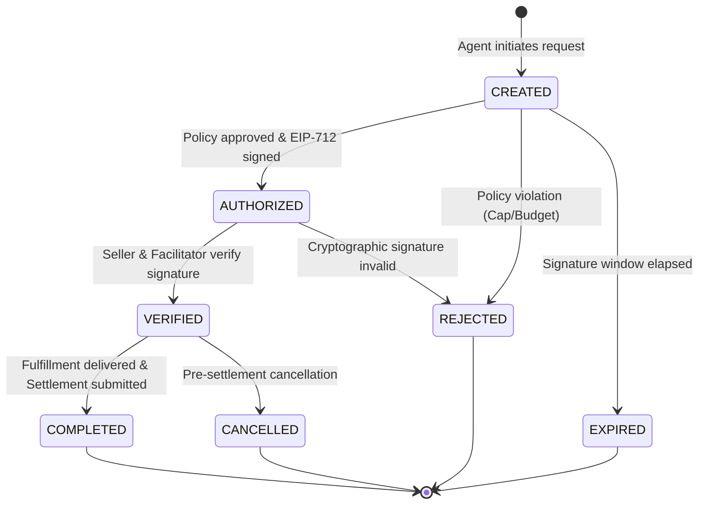

# AgentPay Payment State Machine & Fault Tolerance Specification

## 1. Tri-State Decoupling Philosophy

In high-concurrency distributed systems and Web3 interactions, coupling payment verification, on-chain consensus, and API resource delivery into a single synchronous state is a fatal design flaw:
* **Network Latency & RPC Drops:** Blockchain RPC nodes frequently experience latency spikes or drop connections. A drop during submission does not mean the transaction was not mined.
* **Double-Spending Risk:** Naive retries on timeout can cause multiple on-chain transfers.
* **Orphaned Settlements:** If an on-chain transfer settles successfully but the API provider crashes before returning the response payload, the payer loses funds without receiving the purchased asset.

**AgentPay addresses this by enforcing a strictly decoupled Tri-State Machine:**

```text
[1. Payment Intent State]
CREATED -> AUTHORIZED -> VERIFIED -> [COMPLETED | REJECTED | EXPIRED | CANCELLED]

[2. Settlement State]
NOT_STARTED -> SUBMITTED -> PENDING -> [CONFIRMED | FAILED | REORGED | UNKNOWN]

[3. Fulfillment State]
NOT_STARTED -> PROCESSING -> [DELIVERED | FAILED | RECOVERY_REQUIRED]
```

---

## 2. State Machine Transition Rules

### 2.1 Payment Intent Lifecycle



* **`CREATED`**: Initial request constructed. Pre-checks initialized.
* **`AUTHORIZED`**: The Policy Engine approved the quote and reserved quota; the Agent created an EIP-712/3009 authorization signature.
* **`VERIFIED`**: The Seller API validated the signature off-chain via the Facilitator; the signature is mathematically valid and nonces are unused.
* **`COMPLETED`**: Resource delivered to client and settlement queued or confirmed.
* **`REJECTED`**: Denied by policy or invalid cryptographic proof.
* **`EXPIRED`**: The challenge validity window expired before submission.
* **`CANCELLED`**: Transaction aborted prior to resource delivery.

---

### 2.2 Settlement Lifecycle (On-Chain / Facilitator)

```mermaid
stateDiagram-v2
    [*] --> NOT_STARTED: Intent created
    NOT_STARTED --> SUBMITTED: Facilitator relays raw Tx
    SUBMITTED --> PENDING: Tx hash broadcasted to mempool
    PENDING --> CONFIRMED: Block mined & confirmations >= threshold
    PENDING --> UNKNOWN: RPC timeout / gateway disconnect
    UNKNOWN --> PENDING: Worker probes txpool & finds hash
    UNKNOWN --> CONFIRMED: Worker probes block & finds receipt
    PENDING --> REORGED: Block reorganized; receipt invalidated
    REORGED --> SUBMITTED: Resubmitted with adjusted gas
    PENDING --> FAILED: Execution reverted (e.g. balance moved)
    CONFIRMED --> [*]
    FAILED --> [*]
```



* **`NOT_STARTED`**: Signature is verified off-chain; settlement has not yet been relayed to the blockchain.
* **`SUBMITTED`**: Facilitator signed and broadcasted the transaction.
* **`PENDING`**: Transaction has entered the blockchain mempool with a valid transaction hash.
* **`CONFIRMED`**: Transaction has achieved the required number of block confirmations (e.g., 2 blocks on Base).
* **`UNKNOWN`**: Facilitator encountered an RPC timeout during broadcast. **Must not be treated as failed.**
* **`REORGED`**: Reorganization detected on chain; receipt invalidated; worker initiates resubmission.
* **`FAILED`**: Explicit on-chain revert (e.g., nonce collision, invalid auth parameters).

---

### 2.3 Fulfillment Lifecycle (Business API Delivery)

```mermaid
stateDiagram-v2
    [*] --> NOT_STARTED: Awaiting verification
    NOT_STARTED --> PROCESSING: Signature verified; executing business logic
    PROCESSING --> DELIVERED: HTTP 200 returned with resource payload
    PROCESSING --> FAILED: Business execution error before settlement
    PROCESSING --> RECOVERY_REQUIRED: Upstream crashed / timeout after settlement
    RECOVERY_REQUIRED --> DELIVERED: Replayed via idempotency cache
    DELIVERED --> [*]
    FAILED --> [*]
```



* **`NOT_STARTED`**: Payment is pending.
* **`PROCESSING`**: Seller is running compute/fetching data to construct the response.
* **`DELIVERED`**: HTTP 200 and payload safely received by the Buyer Agent.
* **`FAILED`**: Downstream service threw an error before payment commitment.
* **`RECOVERY_REQUIRED`**: Settlement succeeded or is in-flight, but the Buyer Agent failed to receive the payload due to HTTP connection drop.

---

## 3. Fault Tolerance & Asynchronous Recovery Protocols

### Principle 1: RPC Timeout $\neq$ Failure
When interacting with blockchain RPC nodes or Facilitator endpoints, a network timeout must **NEVER** trigger an immediate retry or assume cancellation.
1. When an RPC call times out, the settlement state transitions to `UNKNOWN`.
2. The asynchronous `reconciliation` background worker acquires an advisory lock on the intent.
3. The worker queries the blockchain node using `eth_getTransactionByHash` or queries the Facilitator audit log by idempotency key.
4. Only if the transaction hash is definitively absent from the mempool and past blocks, and the nonce remains unused, may it be marked as `FAILED` or resubmitted.

### Principle 2: Settled but Failed to Deliver (Graceful Recovery)
If Settlement achieves `CONFIRMED`, but Fulfillment entered `RECOVERY_REQUIRED`:
1. The Seller stores the generated response payload in `ap_idempotency.response_cache`.
2. When the Buyer Agent retries the original request with the same `Idempotency-Key` and original `PAYMENT-SIGNATURE`, the Seller Middleware skips re-verification and immediately returns the cached payload.
3. If the resource cannot be regenerated or recovered, the system initiates an automated business credit or refund event.

### Principle 3: Transparent Client Interception & Replay
1. The Buyer Agent client intercepts all outgoing HTTP requests.
2. If the server responds with `402 Payment Required`:
   * Client parses `PAYMENT-REQUIRED` challenge.
   * Client submits challenge parameters to local Policy Engine.
   * If budget/cap exceeded, throws typed `BudgetExceededException` or `PolicyViolationException`.
   * If approved, signer constructs EIP-712 `TransferWithAuthorization` payload.
   * Replays original request attaching `PAYMENT-SIGNATURE` header.
3. If retry succeeds (HTTP 200), client finalizes reserved quota and passes response to agent logic.
