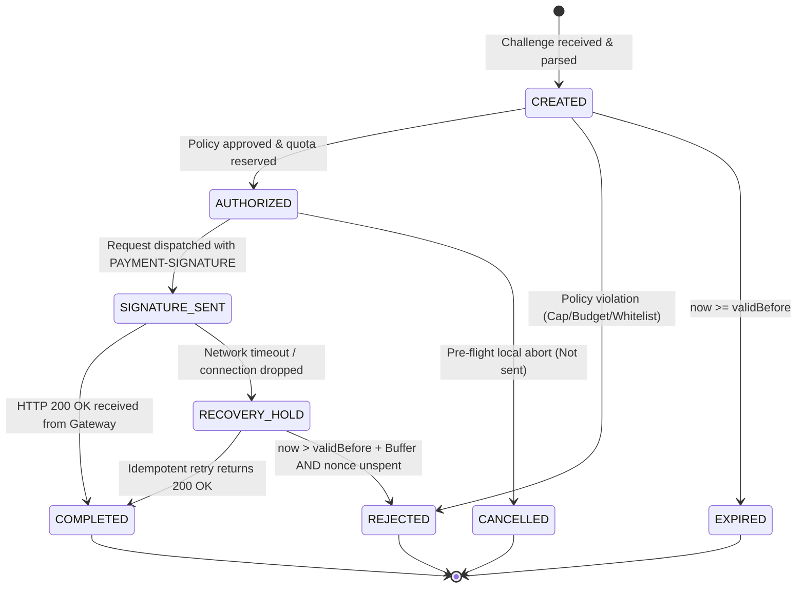
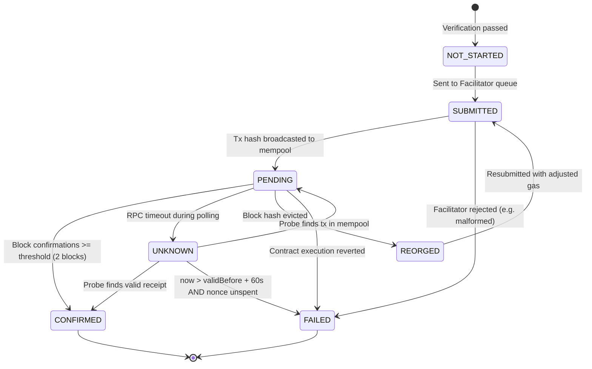

# AgentPay Payment State Machine & Idempotency Specification

> **Specification Version:** 1.2.0  
> **Status:** Draft  
> **Target Runtimes:** Python SDK (`python/agentpay`), Self-hosted Gateway  
> **Task Tracking:** 2026 Plan Milestone M2 (Tasks T1.1, T4.1, T4.2, T4.3, T5.4)

---

## 1. Architectural Boundary: Buyer vs. Gateway Separation

In AgentPay, the **Buyer (Agent Host)** and the **Seller (Self-Hosted Gateway)** run on physically separated infrastructures, maintain separate processes, and persist state in **two separate SQLite databases**:

```text
[ BUYER DOMAIN (Agent Host) ]                    [ GATEWAY DOMAIN (Seller Host) ]
  • Database: buyer_agentpay.db                    • Database: gateway_agentpay.db
  • Buyer Intent State Machine                     • Gateway Settlement State Machine
  • Budget Reservation Ledger (ap_budget_ledger)   • Upstream Fulfillment State Machine
  • Local Keystore / LocalSigner                   • Idempotency Cache (ap_idempotency_cache)
  • Outbound 402 Client Interceptor                • Inbound 402 Middleware & Reverse Proxy
                        │                                    ▲
                        │  HTTP 402 Challenge / Signature    │
                        └────────────────────────────────────┘
```

### Synchronization Protocol
* **Forward Dispatch:** Buyer sends `Idempotency-Key` and `PAYMENT-SIGNATURE` in HTTP request headers.
* **Backward Confirmation:** Gateway returns `HTTP 200` with response payload and receipt headers (`Payment-Receipt`, `Idempotent-Replay`).
* **Failure Boundary:** If HTTP communication breaks between Buyer and Gateway, neither party blindly assumes the other failed. Each follows strict local recovery rules.

---

## 2. Dimension 1: Buyer Intent State Machine (Buyer Host)

Manages the local business intent, quota reservation, and cryptographic signing lifecycle.



### Buyer Transition Matrix & Reservation Guards

| Current State (`From`) | Trigger Event | Guard Condition | Next State (`To`) | Budget Ledger Action |
| :--- | :--- | :--- | :--- | :--- |
| `[*]` | `CHALLENGE_PARSED` | Schema valid | `CREATED` | None. |
| `CREATED` | `POLICY_APPROVE` | Cap, whitelist & budget pass | `AUTHORIZED` | **`reserve()`** quota -> `RESERVED`. |
| `CREATED` | `POLICY_DENY` | Policy rule tripped | `REJECTED` | None; raise `PolicyViolationException`. |
| `CREATED` | `CHALLENGE_TIMEOUT` | `now >= validBefore` | `EXPIRED` | None. |
| `AUTHORIZED` | `LOCAL_ABORT` | Aborted **before** network transmission | `CANCELLED` | **`release()`** quota immediately. |
| `AUTHORIZED` | `DISPATCH_REQUEST` | HTTP request sent with signature | `SIGNATURE_SENT` | **PRESERVE `RESERVED`**. DO NOT RELEASE. |
| `SIGNATURE_SENT` | `HTTP_200_OK` | Server returned 200 + valid response | `COMPLETED` | **`commit()`** quota -> `COMMITTED`. |
| `SIGNATURE_SENT` | `NETWORK_TIMEOUT` | Connection dropped / 5xx / timeout | `RECOVERY_HOLD` | **PRESERVE `RESERVED`**. DO NOT RELEASE. |
| `RECOVERY_HOLD` | `RETRY_SUCCESS` | Idempotent retry returns 200 OK | `COMPLETED` | **`commit()`** quota -> `COMMITTED`. |
| `RECOVERY_HOLD` | `EXPIRED_UNSPENT` | `now > validBefore + 60s` **AND** chain confirms nonce never spent | `REJECTED` | **`release()`** quota safe to release. |

> [!CAUTION]
> **Anti-Overspend Invariant (P0-1 Fix):** Once an intent enters `SIGNATURE_SENT`, network failure **MUST NOT** trigger `release()`. The gateway may have successfully received the signature and settled on-chain. Releasing prematurely causes double-spending and budget bypass.

---

## 3. Dimensions 2 & 3: Gateway Lifecycle (Gateway Host)

### 3.1 Gateway Settlement Lifecycle (Blockchain Transfer)

Tracks blockchain consensus managed by the Gateway and Facilitator.



### Settlement Transition Rules

| Current State (`From`) | Trigger Event | Guard Condition | Next State (`To`) | Settlement Action |
| :--- | :--- | :--- | :--- | :--- |
| `NOT_STARTED` | `ENQUEUE_SETTLEMENT` | Verification token valid | `SUBMITTED` | Relay to Facilitator `/v1/settle`. |
| `SUBMITTED` | `BROADCAST_OK` | Tx hash received | `PENDING` | Begin block polling. |
| `SUBMITTED` | `FACILITATOR_REJECT` | Nonce collision or Facilitator error | `FAILED` | Record error message. Terminal state. |
| `PENDING` | `BLOCK_CONFIRMED` | Confirmations >= threshold (2 blocks) | `CONFIRMED` | Terminal success state. |
| `PENDING` | `RPC_TIMEOUT` | RPC drops or latency spike | `UNKNOWN` | Flag for `reconcile()` worker probe. |
| `PENDING` | `REORG_DETECTED` | Block hash evicted | `REORGED` | Resubmit to Facilitator. |
| `PENDING` | `TX_REVERTED` | Contract reverted on-chain | `FAILED` | Terminal state. |
| `REORGED` | `RESUBMIT_OK` | New tx broadcast | `SUBMITTED` | New tx hash assigned. |
| `UNKNOWN` | `PROBE_RECEIPT_OK` | Receipt found with status=1 | `CONFIRMED` | Terminal success state. |
| `UNKNOWN` | `PROBE_MEMPOOL` | Hash found in txpool | `PENDING` | Resume polling. |
| `UNKNOWN` | `PROBE_DEFINITIVE_FAILED` | `now > validBefore + 60s` **AND** nonce unspent | `FAILED` | Terminal state. |

---

### 3.2 Gateway Fulfillment Lifecycle (Upstream API Delivery)

Tracks whether the paying client received the upstream resource payload.

| Current State (`From`) | Trigger Event | Guard Condition | Next State (`To`) | Fulfillment Action |
| :--- | :--- | :--- | :--- | :--- |
| `NOT_STARTED` | `VERIFY_SUCCESS` | Verification token valid | `PROCESSING` | Forward request to upstream target API. |
| `PROCESSING` | `UPSTREAM_2XX` | Upstream returns 2xx | `DELIVERED` | Cache response; deliver HTTP 200 to client. |
| `PROCESSING` | `UPSTREAM_TIMEOUT` | Upstream times out | `RECOVERY_REQUIRED` | Preserve state; do NOT double charge. |
| `PROCESSING` | `UPSTREAM_5XX` | Upstream error 5xx | `RECOVERY_REQUIRED` | Preserve state for idempotent retry. |
| `RECOVERY_REQUIRED` | `IDEMPOTENT_RETRY` | Client retries with same `(payer, key)` | `PROCESSING` | Re-attempt upstream call for free. |
| `RECOVERY_REQUIRED` | `CACHE_HIT` | Upstream call succeeded previously | `DELIVERED` | Return cached payload immediately. |

---

## 4. Composite State Whitelist (Legal State Combinations)

To eliminate ambiguous edge cases, only the following composite states are **LEGAL**. Any combination outside this whitelist is an illegal anomaly that alerts the monitoring system:

| Intent State (Buyer) | Settlement State (Gateway) | Fulfillment State (Gateway) | System Resolution & Invariant |
| :---: | :---: | :---: | :--- |
| `COMPLETED` | `CONFIRMED` | `DELIVERED` | 🟢 **Healthy Final State:** Normal happy path. |
| `COMPLETED` | `SUBMITTED` / `PENDING` | `DELIVERED` | 🟡 **Optimistic Delivery:** Buyer has data; settlement queued. |
| `RECOVERY_HOLD` | `CONFIRMED` | `RECOVERY_REQUIRED` | 🔴 **Orphaned Settlement:** Client retry MUST replay upstream call for free. |
| `RECOVERY_HOLD` | `UNKNOWN` | `RECOVERY_REQUIRED` | ⚠️ **Network Ambiguity:** Reconciler probes chain. Never double-charge client. |
| `REJECTED` | `FAILED` | `FAILED` | ⚪ **Clean Abort:** Verification failed or nonce unspent after timeout. |

---

## 5. Precise Reconciliation Protocol (`reconcile()` Algorithm)

The reconciliation probe safely determines finality without race conditions or false failure assumptions:

```python
def reconcile_gateway_settlement(intent, blockchain_client, safe_buffer_seconds: int = 60):
    now = current_unix_timestamp()
    
    # P0-2 Fix: Only evaluate final failure AFTER validBefore + safety margin
    if intent.settlement_status == "UNKNOWN":
        if intent.tx_hash:
            receipt = blockchain_client.get_transaction_receipt(intent.tx_hash)
            if receipt and receipt.status == 1:
                intent.settlement_status = "CONFIRMED"
                intent.block_number = receipt.block_number
                return
            elif receipt and receipt.status == 0:
                intent.settlement_status = "FAILED"
                return

        # If hash dropped or unmined, check blockchain state:
        if now > (intent.valid_before + safe_buffer_seconds):
            # Safe margin elapsed: check on-chain authorization state
            auth_state = blockchain_client.get_eip3009_state(intent.payer_address, intent.nonce)
            if auth_state == "UNUSED":
                # Nonce definitively never used and window expired: 100% safe to mark FAILED
                intent.settlement_status = "FAILED"
            elif auth_state == "USED":
                # Nonce was consumed: verify it was TransferWithAuthorization, not cancelAuthorization
                transfers = blockchain_client.get_transfer_events(
                    sender=intent.payer_address, 
                    recipient=intent.payee_address,
                    block_range=(intent.created_at_block, "latest")
                )
                matching = [t for t in transfers if t.value == intent.amount_base_units]
                if matching:
                    intent.settlement_status = "CONFIRMED"
                else:
                    intent.settlement_status = "FAILED"  # Consumed via cancellation or other
```

---

## 6. Idempotency Key Specification

### 6.1 Scoping & Uniqueness
* **Composite Key:** Idempotency keys are strictly scoped by payer address:
  $$\text{Scope} = \mathbf{UNIQUE(payer\_address,\ idempotency\_key)}$$
* Prevents cross-agent key collisions or denial-of-service squatting.

### 6.2 Safe Retry Semantics (P1-4)
* Gateway automatically retries upstream **only for safe HTTP methods** (`GET`, `HEAD`, `OPTIONS`).
* For non-idempotent methods (`POST`, `PUT`), Gateway transparently forwards `Idempotency-Key` to upstream services. If upstream lacks idempotency support, Gateway returns cached 402 challenge until explicit client re-dispatch.
