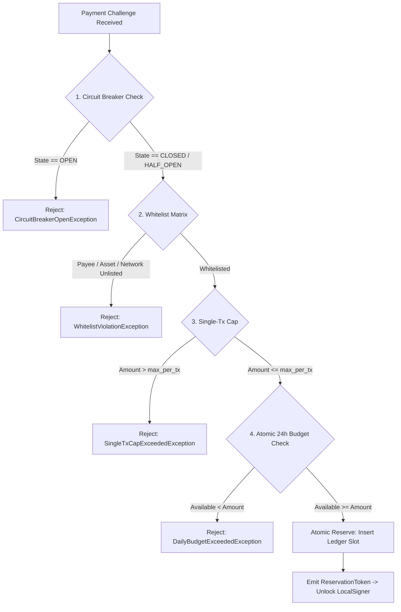
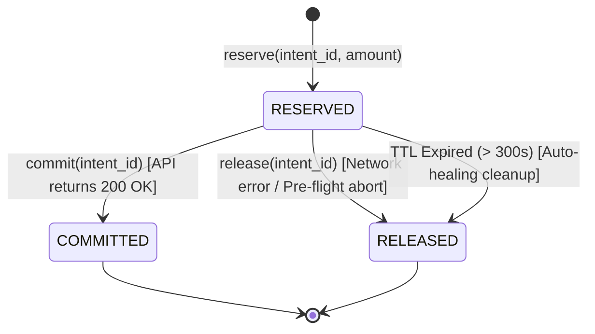
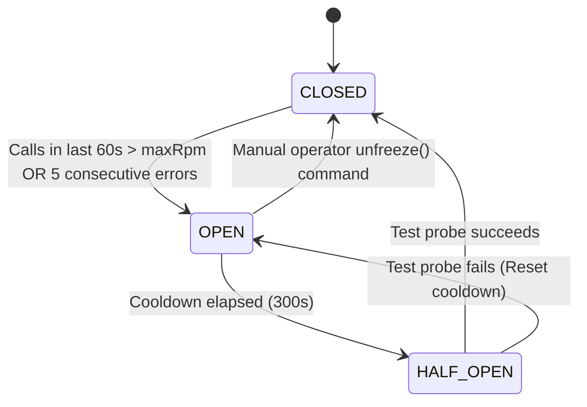

# AgentPay Policy Engine Specification

> **Specification Version:** 1.0.0  
> **Status:** Standard  
> **Target Implementations:** Python SDK (`agentpay.policy`), SQLite Ledger  
> **Task Tracking:** 2026 Plan Milestone M1 (Tasks T1.3, T2.1, T2.2, T2.3, T2.4)

---

## 1. Overview & Policy Architecture

The **Policy Engine** operates as an independent, deterministic financial firewall between the untrusted agent/LLM context and the cryptographic wallet signer.



---

## 2. Policy Schema Definition

The policy configuration is statically loaded from a YAML configuration file or programmatically initialized via Pydantic schema:

```yaml
version: "1.0"
policyId: "pol_dev_default"
name: "Default Autonomous Agent Financial Firewall"

# 1. Hard Monetary Limits (Integer base units; no floating point)
limits:
  maxPerTxBaseUnits: 1000000          # 1.0 USDC (6 decimals: 1,000,000)
  rollingBudget24hBaseUnits: 10000000  # 10.0 USDC (6 decimals: 10,000,000)
  lifetimeBudgetBaseUnits: 100000000   # 100.0 USDC (optional hard stop)

# 2. Strict Whitelisting Matrix
whitelists:
  allowedPayees:
    - "0x5A0b54D5dc17e0AadC383d2db43B0a0D3E029c4c"  # Checksummed EVM addresses
  allowedAssets:
    - "0x036CbD53842c5426634e7929541eC2318f3dCF7e"  # Base Sepolia USDC
  allowedNetworks:
    - "eip155:84532"                                  # Base Sepolia (CAIP-2)
  allowedDomains:
    - "api.weather-oracle.xyz"
    - "gateway.internal"

# 3. Anomaly & Infinite-Loop Circuit Breaker
circuitBreaker:
  maxRpm: 15                                          # Max requests allowed in 60s
  consecutiveFailureThreshold: 5                      # Auto-trip after 5 consecutive 4xx/5xx
  cooldownSeconds: 300                                # 5-minute cooldown before HALF_OPEN
  autoFreezeOnBreaker: true                           # Require operator unlock on trip
```

---

## 3. Two-Phase Reservation Protocol (Reserve - Commit - Release)

To prevent race conditions across concurrent agent threads while protecting against unearned fund losses on downstream timeouts, the engine implements a strict **Two-Phase Reservation Protocol**:



### 3.1 Interface Contract & Semantics

```python
class IPolicyEngine:
    def reserve(
        self,
        intent_id: str,
        amount: int,
        payee: str,
        asset: str,
        network: str,
        domain: str | None = None
    ) -> ReservationToken:
        """
        Phase 1: Validates whitelist, cap, breaker, and atomically locks quota.
        Raises PolicyViolationException subtypes if check fails.
        """
        ...

    def commit(self, intent_id: str) -> None:
        """
        Phase 2a: Confirms final payment execution. Moves quota from RESERVED to COMMITTED.
        Idempotent: Subsequent calls for the same intent_id are no-ops.
        """
        ...

    def release(self, intent_id: str, reason: str | None = None) -> None:
        """
        Phase 2b: Aborts reservation. Restores quota immediately to the available pool.
        Idempotent: Subsequent calls for the same intent_id are no-ops.
        """
        ...

    def cleanup_expired_reservations(self, ttl_seconds: int = 300) -> int:
        """
        Housekeeping: Scans for reservations older than ttl_seconds that were
        never committed or released (e.g. agent crashed), and marks them RELEASED.
        """
        ...
```

### 3.2 Pre-Conditions & Invariants
1. **Idempotent Reservations:** Calling `reserve()` with an existing `intent_id` that is already in `RESERVED` state returns the existing `ReservationToken` without deducting extra funds.
2. **Terminal Inviolability:** Calling `release()` on an already `COMMITTED` intent **MUST** raise `ReservationAlreadyFinalizedException`.
3. **Lease TTL:** Every reservation carries an `expires_at = now + 300s`. Quota locked by crashed processes is automatically reclaimed upon expiration.

---

## 4. Mathematical Model for 24-Hour Rolling Budget

Traditional midnight-reset budgets allow an attacker to spend the full budget at 23:59 and another full budget at 00:01. AgentPay enforces a continuous **Sliding-Window Rolling Budget**:

$$\text{Committed}_{24h} = \sum \{ L.\text{amount} \mid L.\text{status} = \text{'COMMITTED'} \land L.\text{created\_at} \ge (T_{\text{now}} - 86400) \}$$

$$\text{ActiveReserved} = \sum \{ L.\text{amount} \mid L.\text{status} = \text{'RESERVED'} \land L.\text{expires\_at} > T_{\text{now}} \}$$

$$\text{AvailableBudget} = \text{RollingBudget}_{24h} - (\text{Committed}_{24h} + \text{ActiveReserved})$$

**Decision Rule:**
$$\text{If } \text{AvailableBudget} < \text{RequestedAmount} \implies \mathbf{REJECT}\ (\text{DailyBudgetExceededException})$$

### SQLite Atomic Evaluation Statement
```sql
-- Atomically executed within BEGIN IMMEDIATE transaction
SELECT 
    p.is_frozen,
    p.max_per_tx_base_units,
    p.rolling_budget_24h_base_units,
    COALESCE(SUM(l.amount), 0) AS total_locked
FROM ap_policy p
LEFT JOIN ap_policy_ledger l 
    ON p.id = l.policy_id
    AND (
        (l.status = 'COMMITTED' AND l.created_at >= datetime('now', '-24 hours'))
        OR 
        (l.status = 'RESERVED' AND l.expires_at > datetime('now'))
    )
WHERE p.id = :policy_id
GROUP BY p.id;
```

---

## 5. Anomaly Circuit Breaker Algorithm

The circuit breaker protects against infinite loops and upstream cascading failures:



### Transition Guards:
* **`CLOSED` $\to$ `OPEN`**:
  * Sliding log tracks request timestamps. If $\text{Count}(T > \text{now} - 60) > \text{maxRpm}$, transition to `OPEN`.
  * If consecutive error counter reaches `consecutiveFailureThreshold`, transition to `OPEN`.
* **`OPEN` State Behavior**:
  * Instantly raises `CircuitBreakerOpenException` without database locks or network overhead.
  * Records critical audit log with reason (`BURST_LOOP_DETECTED` or `CONSECUTIVE_ERRORS`).
* **`HALF_OPEN` State Behavior**:
  * Exactly 1 transaction is allowed through to test upstream health.
  * If it receives 200 OK, reset error counter and return to `CLOSED`.
  * If it fails or times out, return to `OPEN` for another full cooldown window.

---

## 6. Exception Hierarchy

All exceptions emitted by the policy engine are strongly typed to allow downstream caller handling:

```text
AgentPayException
└── PolicyViolationException
    ├── SingleTxCapExceededException
    ├── DailyBudgetExceededException
    ├── LifetimeBudgetExceededException
    ├── WhitelistViolationException
    │   ├── PayeeNotWhitelistedException
    │   ├── AssetNotWhitelistedException
    │   ├── NetworkNotWhitelistedException
    │   └── DomainNotWhitelistedException
    ├── CircuitBreakerOpenException
    ├── PolicyFrozenException
    └── ReservationException
        ├── ReservationExpiredException
        └── ReservationAlreadyFinalizedException
```
